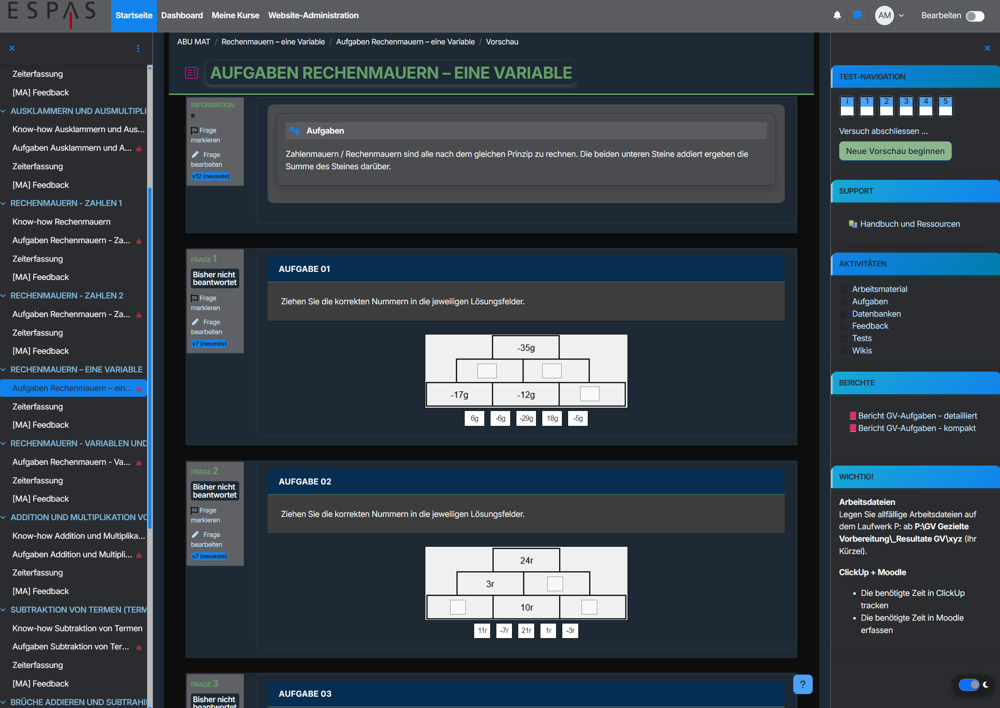

# ESPAS Moodle Theme

This repository contains the central customizations for the appearance and user interface of Moodle in the **ESPAS design**.

The theme extends Moodle's standard Boost theme with a comprehensive ESPAS design system, custom layouts, activity styling, course-specific adaptations, Dark Mode, and JavaScript-based enhancements.

The customization is mainly divided into three areas:

| Area                   | Purpose                                                       |
| ---------------------- | ------------------------------------------------------------- |
| `theme_boost/scss`     | Central ESPAS design system and visual styling                |
| `additionalhtmlhead`   | Inter font, Dark Mode CSS, and early Dark Mode initialization |
| `additionalhtmlfooter` | Dark Mode switch and quiz comment popup JavaScript            |

---

# Screenshots

The following screenshots should provide a visual overview of the main ESPAS Moodle customizations.

<!-- Replace the image paths with the actual screenshots -->

|                     ESPAS Moodle Frontpage                    |                   ESPAS Course View                   |
| :-----------------------------------------------------------: | :---------------------------------------------------: |
|  |  |

|                  Complex Quiz Question                  |                    ESPAS Dark Mode                    |
| :-----------------------------------------------------: | :---------------------------------------------------: |
|  |  |

### Recommended screenshots

The four screenshots should ideally show:

1. **Dashboard / Start Page** – general ESPAS layout and navigation
2. **Course View** – cards, blocks, course index, and activities
3. **Complex Quiz Question** – demonstrating the increased content width
4. **Dark Mode** – demonstrating the Dark Mode implementation

---

# Configuration in Moodle

The customizations are configured directly in the Moodle administration interface.

| Customization | Moodle location                                                                                                    |
| ------------- | ------------------------------------------------------------------------------------------------------------------ |
| CSS / SCSS    | [Moodle Theme Settings](https://moodle-espas.ch/admin/settings.php?section=themesettingboost#theme_boost_advanced) |
| JavaScript    | [Additional HTML](https://moodle-espas.ch/admin/settings.php?section=additionalhtml)                               |

## CSS / SCSS

The main ESPAS styling is configured under:

**Site administration → Appearance → Themes → Boost → Advanced settings**

The SCSS is entered in the **Raw SCSS** field.

This contains the central ESPAS design system, including colors, typography, layout, navigation, cards, Moodle blocks, activities, quiz styling, course-specific styling, and print views.

## JavaScript and Additional HTML

JavaScript functionality is configured under:

**Site administration → Plugins → Filters → Additional HTML**

The code is divided between:

* **Additional HTML head**
* **Additional HTML footer**

The head contains the Inter font, Dark Mode CSS, and the early Dark Mode initialization.

The footer contains the Dark Mode switch, state persistence, and quiz comment popup functionality.

---

# Table of Contents

* [Screenshots](#screenshots)
* [Configuration in Moodle](#configuration-in-moodle)
* [1. `theme_boost/scss`](#1-theme_boostscss)

  * [1.1 Global Variables and Color System](#11-global-variables-and-color-system)
  * [1.2 Global Typography](#12-global-typography)
  * [1.3 Page Backgrounds](#13-page-backgrounds)
  * [1.4 Admin and Documentation Areas](#14-admin-and-documentation-areas)
  * [1.5 Login Page](#15-login-page)
  * [1.6 Main Content Area and Layout](#16-main-content-area-and-layout)
  * [1.7 Sticky Page Header](#17-sticky-page-header)
  * [1.8 Navigation](#18-navigation)
  * [1.9 Buttons](#19-buttons)
  * [1.10 Badges and Alerts](#110-badges-and-alerts)
  * [1.11 Cards](#111-cards)
  * [1.12 Moodle Blocks](#112-moodle-blocks)
  * [1.13 Moodle Activities](#113-moodle-activities)
  * [1.14 Course Areas](#114-course-areas)
  * [1.15 Quiz](#115-quiz)
  * [1.16 Wiki and Feedback](#116-wiki-and-feedback)
  * [1.17 Sticky Notes](#117-sticky-notes)
  * [1.18 Blockquotes](#118-blockquotes)
  * [1.19 Print View](#119-print-view)
* [2. `additionalhtmlhead`](#2-additionalhtmlhead)

  * [2.1 Inter Font](#21-inter-font)
  * [2.2 Dark Mode Initialization](#22-dark-mode-initialization)
* [3. Dark Mode CSS](#3-dark-mode-css)

  * [3.1 Dark Mode Colors](#31-dark-mode-colors)
  * [3.2 Dark Mode Background](#32-dark-mode-background)
  * [3.3 Dark Mode Content](#33-dark-mode-content)
  * [3.4 Dark Mode for Quiz Questions](#34-dark-mode-for-quiz-questions)
  * [3.5 Dark Mode for Moodle Blocks](#35-dark-mode-for-moodle-blocks)
  * [3.6 Dark Mode Switch](#36-dark-mode-switch)
* [4. `additionalhtmlfooter`](#4-additionalhtmlfooter)

  * [4.1 Quiz Comment Popup](#41-quiz-comment-popup)
* [5. Dark Mode Switch – JavaScript](#5-dark-mode-switch--javascript)

  * [5.1 Loading the Stored State](#51-loading-the-stored-state)
  * [5.2 Toggling Dark Mode](#52-toggling-dark-mode)
  * [5.3 Saving the State](#53-saving-the-state)
* [6. Interaction Between the Three Areas](#6-interaction-between-the-three-areas)

  * [6.1 Responsibilities at a Glance](#61-responsibilities-at-a-glance)
* [7. Dark Mode – Technical Flow](#7-dark-mode--technical-flow)
* [8. Important Technical Notes](#8-important-technical-notes)

  * [8.1 CSS Variables](#81-css-variables)
  * [8.2 Dark Mode](#82-dark-mode)
  * [8.3 JavaScript and Dark Mode](#83-javascript-and-dark-mode)
* [9. Summary](#9-summary)

---

# 1. `theme_boost/scss`

The SCSS customizations form the central location for the global appearance of Moodle.

The following areas are covered:

* Colors
* Typography
* Layout
* Navigation
* Cards
* Moodle blocks
* Activities
* Course sections
* Quiz
* Wiki and Feedback
* ESPAS-specific areas
* Sticky notes
* Blockquotes
* Print views

---

## 1.1 Global Variables and Color System

At the beginning of the SCSS, the central ESPAS color system is defined using CSS variables:

```scss
:root {
    --primary: #008cba;
    --secondary: #047b20;
    --success: #28a745;
    ...
}
```

The main semantic colors include:

| Variable      | Meaning                |
| ------------- | ---------------------- |
| `--primary`   | Primary blue           |
| `--secondary` | Secondary green        |
| `--success`   | Success                |
| `--info`      | Information            |
| `--warning`   | Warning                |
| `--danger`    | Error / danger         |
| `--yellow`    | Yellow                 |
| `--light`     | Light base color       |
| `--dark`      | Dark base color        |
| `--gray-*`    | Various shades of gray |

Utility classes are based on these variables:

```text
.bg-primary
.text-primary
.border-primary
```

This allows Moodle elements to use the centrally defined ESPAS colors without repeatedly defining hexadecimal values.

The variables are also redefined for Dark Mode, which makes this central color system particularly important.

---

## 1.2 Global Typography

The Moodle interface generally uses the **Inter** font:

```scss
font-family: "Inter", sans-serif !important;
```

Additional typography settings include:

* Letter spacing
* Line height
* Base font size
* Font weights
* Headings
* Link colors

The headings `h1`, `h2`, and `h3` are displayed in green and uppercase by default.

The actual font integration is handled through `additionalhtmlhead`.

---

## 1.3 Page Backgrounds

Different Moodle pages use individual ESPAS background images.

Examples include:

```scss
body#page-site-index,
body#page-course-index-category,
body#page-my-index
```

These pages use the ESPAS background design.

Additional backgrounds exist for specific courses and course categories.

This allows individual parts of Moodle to have their own visual identity while remaining part of the overall ESPAS design.

---

## 1.4 Admin and Documentation Areas

The Moodle administration area has its own accent color:

```scss
.path-admin {
    --admin-accent: #dc5656;
}
```

This gives the administration area, for example, a red navbar and corresponding accent lines.

Specific documentation areas, such as `category-114` and `category-106`, use a dedicated turquoise/green color scheme:

```scss
--doc-accent: #5b8b8b;
```

This allows documentation areas to be visually distinguished from the standard Moodle interface.

---

## 1.5 Login Page

The login area is individually styled using `.login-container`.

The login box receives:

* Light gray background
* Additional padding
* Shadow
* Additional bottom spacing

The Dark Mode switch is hidden on the login page.

---

## 1.6 Main Content Area and Layout

The ESPAS theme introduces a modern container/card-based layout for the main Moodle content area.

The main content area receives:

* White background
* Rounded corners
* Thin border
* Subtle shadow
* Internal padding
* Increased maximum width

The central container is customized through:

```scss
body #page.drawers .main-inner
```

### ⚠️ Important: Content Width increased from ~830 px to ~1200 px

One of the most important ESPAS layout changes is the expansion of the main Moodle content area.

The standard Moodle layout provides approximately **830 px** of usable content width. This was insufficient for complex Moodle content, especially for **complex quiz questions**.

The ESPAS theme therefore uses a maximum content width of approximately:

> # **1200 px**

This provides roughly **370 px more horizontal space** than the standard layout.

### Why was this necessary?

The standard ~830 px width can cause complex content to become unnecessarily compressed.

This is particularly noticeable with quiz questions containing:

* Long question text
* Complex answer structures
* Tables
* Multiple columns
* Drag & Drop elements
* Large or nested layouts
* Complex question types

The limited width can lead to:

* Excessive line wrapping
* Reduced readability
* Very long pages
* Cramped answer areas
* Poor use of available screen space

The ESPAS **~1200 px content width** provides significantly more room for complex learning and assessment content.

This is therefore an important **usability improvement**, not only a visual design change.

---

## 1.7 Sticky Page Header

The Moodle page header is fixed while scrolling:

```scss
#page-header {
    position: sticky;
    top: 60px;
}
```

The header also receives a colored bottom border.

The `--secondary` color is used by default.

---

## 1.8 Navigation

The navigation is designed to be lighter, more compact, and visually consistent with the ESPAS design.

The following areas are customized:

* Navbar
* Navigation text
* Background colors
* Hover states
* Active navigation
* Breadcrumbs
* Secondary navigation
* Course Index

The Moodle Course Index has also been extensively customized.

Course sections receive custom:

* Backgrounds
* Spacing
* Active states
* Highlights

---

## 1.9 Buttons

Moodle buttons are standardized using a variable-based system:

```scss
.btn {
    --btn-bg: ...;
    --btn-border: ...;
    --btn-color: ...;
}
```

This maps different Moodle button types to the ESPAS color system.

Supported variants include:

* Primary
* Secondary
* Success
* Warning
* Danger
* Other Moodle button variants

Buttons also receive:

* Rounded corners
* Defined font weights
* Hover effects

Special Moodle buttons, including drawer and icon buttons, are also customized.

---

## 1.10 Badges and Alerts

The central ESPAS color system is also applied to:

* Badges
* Alerts
* Warning messages
* Success messages
* Error messages

This ensures that these components remain consistent with the overall ESPAS design language.

---

## 1.11 Cards

Moodle cards receive a consistent ESPAS design.

Typical properties include:

```scss
border-radius: 12px;
```

Cards also receive:

* Subtle borders
* Light shadows
* White backgrounds
* Consistent spacing

Courseboxes and course cards are individually styled.

A subtle lift effect is applied when hovering over course cards.

---

## 1.12 Moodle Blocks

A large part of the SCSS is dedicated to the styling of Moodle blocks.

Blocks receive:

* Rounded corners
* Borders
* White backgrounds
* Shadows
* Hover effects
* Consistent spacing

Block headers use colored gradients.

Different block types use different accent colors:

| Block Type            | Color             |
| --------------------- | ----------------- |
| HTML                  | Blue              |
| Online Users          | Green             |
| Calendar              | Blue              |
| Navigation / Settings | Dark green / dark |
| Private Files         | Turquoise         |

This makes different Moodle block types easier to distinguish visually.

---

## 1.13 Moodle Activities

Moodle activities are styled using the `.activity` selector and are displayed in a card-like layout.

Different activity types receive different colors.

| Activity   | Color  |
| ---------- | ------ |
| Quiz       | Blue   |
| Feedback   | Green  |
| Wiki       | Yellow |
| Book       | Yellow |
| Resource   | Yellow |
| URL        | Blue   |
| Assignment | Gray   |

Additional styling fixes hover and `z-index` issues related to activity dropdowns.

---

## 1.14 Course Areas

Additional styling exists for specific ESPAS courses and course categories.

These customizations include:

* Course teasers
* Competency boxes
* Learning process graphics
* Course-specific backgrounds
* Wiki
* Quiz
* Feedback
* Timetracking
* Category-specific layouts

Some categories contain extensive course- or subject-specific customizations.

In particular, `category-53` contains numerous course-specific adaptations.

---

## 1.15 Quiz

Quiz functionality is one of the most extensively customized areas of the theme.

The SCSS provides specific styling for:

* Questions
* Question text
* Answer areas
* Feedback
* Quiz headers
* Comments
* Quiz navigation
* Answer history

Different Moodle question types are also supported, including:

* Multiple Choice
* Drag & Drop
* Cloze
* Matching
* Short Answer
* Numerical

The increased main content width of approximately **1200 px** is particularly important for these quiz layouts.

Complex questions can use the additional horizontal space instead of being compressed into the standard ~830 px layout.

---

## 1.16 Wiki and Feedback

Wiki pages use a dedicated yellowish color scheme.

Feedback activities use a green color scheme.

This allows activity types to remain visually recognizable even inside their respective activity pages.

---

## 1.17 Sticky Notes

A dedicated styling system exists for sticky notes:

```scss
.notizzettel[data-note]
```

The `data-note` attribute is used to create a yellow information note.

The note includes:

* Yellow background
* Colored left border
* Shadow
* Folded corner

---

## 1.18 Blockquotes

`blockquote` elements are styled as information or notification boxes.

Additional variants are enabled through:

```scss
blockquote:has(h5)
```

and:

```scss
blockquote:has(h6)
```

This allows the heading inside a blockquote to determine the type of information box.

For example, the blockquote can be visually presented as:

* Standard information
* Warning
* Error message

---

## 1.19 Print View

A dedicated `@media print` section is used for the **GV task report**.

The print styling includes:

* A4 landscape format
* Page margins
* Arial instead of Inter
* Custom font sizes
* Table widths
* Table headers
* Colors
* Line wrapping
* Page breaks
* Removal of shadows
* Removal of link URLs
* Printable background colors

The print layout is specifically targeted at:

```text
#printablediv
```

This prevents the print styling from unnecessarily affecting other Moodle content.

---

# 2. `additionalhtmlhead`

The `additionalhtmlhead` contains two central functions:

1. Inter font integration
2. Dark Mode CSS and early Dark Mode initialization

---

## 2.1 Inter Font

The Inter font is loaded using Google Fonts:

```html
<link
    href="https://fonts.googleapis.com/css2?family=Inter:wght@300;400;500;600;700&display=swap"
    rel="stylesheet">
```

The SCSS can then use:

```scss
font-family: "Inter", sans-serif;
```

This provides the main ESPAS typography throughout Moodle.

---

## 2.2 Dark Mode Initialization

At the beginning of the page load, the stored Dark Mode state is read from the browser:

```javascript
localStorage.getItem("espas-darkmode")
```

If the stored value is `on`, the following class is added immediately:

```javascript
document.documentElement.classList.add("darkmode");
```

The HTML element then becomes:

```html
<html class="darkmode">
```

The early initialization is important because it minimizes the visible transition from Light Mode to Dark Mode while Moodle is loading.

The user's preference is stored persistently in the browser.

---

# 3. Dark Mode CSS

The complete Dark Mode CSS is currently located in `additionalhtmlhead`.

Dark Mode is activated through:

```css
html.darkmode
```

---

## 3.1 Dark Mode Colors

The central ESPAS CSS variables are redefined for Dark Mode:

```scss
html.darkmode {
    --primary: #1283ed;
    --secondary: #659e65;
    ...
    --white: #1d2a35;
    --dark: #f5f5f5;
}
```

The same variables used by the standard ESPAS design therefore receive Dark Mode-specific values.

This means that many existing SCSS rules automatically adapt when the `darkmode` class is present.

---

## 3.2 Dark Mode Background

The basic Moodle layout is converted to a dark blue/gray appearance:

```css
html.darkmode,
html.darkmode body,
html.darkmode #page,
html.darkmode #page-wrapper
```

This provides the foundation for the Dark Mode interface.

---

## 3.3 Dark Mode Content

Texts, links, headings, tables, and Moodle components receive specific Dark Mode styling.

The following areas are covered extensively:

* Main layout
* Cards
* Tables
* Quiz tables
* Gradebook
* Forms
* Tabs
* Modals
* Dropdowns
* Alerts
* Activities
* Course Index
* Navbar
* Footer
* Pagination
* Tooltips
* Quiz navigation
* Popovers
* Notifications

This ensures that the complete Moodle interface remains usable and readable in Dark Mode.

---

## 3.4 Dark Mode for Quiz Questions

Quiz questions receive dedicated Dark Mode styling.

The implementation covers, among others:

* Correct answers
* Incorrect answers
* Feedback
* Comments
* Multiple Choice
* Drag & Drop
* Cloze
* Matching
* Short Answer
* Numerical questions

Moodle's native quiz states and colors are adapted to maintain sufficient contrast and readability.

---

## 3.5 Dark Mode for Moodle Blocks

Moodle blocks are also adapted to Dark Mode.

The following areas are specifically considered:

* Backgrounds
* Text
* Links
* Headers
* Popovers
* Notifications
* Block-specific colors

This ensures that the custom ESPAS block styling remains usable in Dark Mode.

---

## 3.6 Dark Mode Switch

The HTML/CSS for the visible Dark Mode switch is prepared in `additionalhtmlhead`.

The switch uses elements such as:

```text
.darkmode-control
.darkmode-switch
.slider
.switch-text
```

The switch is hidden on the login page.

---

# 4. `additionalhtmlfooter`

The `additionalhtmlfooter` contains the JavaScript functionality.

Two main functions are implemented:

1. Quiz comment popup
2. Dark Mode switch

---

## 4.1 Quiz Comment Popup

The script first checks whether the current page is the Moodle quiz comment popup:

```javascript
body#page-mod-quiz-comment
```

If this is the case, the script checks whether the main Moodle window is currently using Dark Mode.

If Dark Mode is active, the popup receives:

```javascript
popupBody.classList.add("darkmode");
```

This allows the popup to use the same Dark Mode styling as the main Moodle interface.

The popup is approximately configured to:

```text
950 × 1200 px
```

and positioned in the center of the screen.

The responsibilities are divided between SCSS and JavaScript:

| Area                   | Responsibility                                                |
| ---------------------- | ------------------------------------------------------------- |
| `theme_boost/scss`     | Visual styling of the popup                                   |
| `additionalhtmlfooter` | Popup detection, size, positioning, and Dark Mode inheritance |

---

# 5. Dark Mode Switch – JavaScript

The second JavaScript block dynamically creates the Dark Mode switch.

Before creating it, the script checks:

```javascript
document.getElementById("darkmode-toggle")
```

This prevents Moodle from creating multiple Dark Mode switches.

The switch HTML is then created dynamically and appended to the `body`.

---

## 5.1 Loading the Stored State

When the switch is created, the stored state is read:

```javascript
localStorage.getItem("espas-darkmode")
```

If the value is `on`, the checkbox is activated.

This ensures that the switch reflects the user's current preference.

---

## 5.2 Toggling Dark Mode

When the checkbox changes, the following is executed:

```javascript
document.documentElement.classList.toggle(
    "darkmode",
    isDark
);
```

This adds or removes:

```html
<html class="darkmode">
```

The `darkmode` class is the central mechanism controlling the Dark Mode CSS.

---

## 5.3 Saving the State

The current state is stored in the browser:

```javascript
localStorage.setItem(
    "espas-darkmode",
    isDark ? "on" : "off"
);
```

The state therefore remains available when Moodle is opened again.

Possible values are:

```text
on
off
```

The storage key is:

```text
espas-darkmode
```

---

# 6. Interaction Between the Three Areas

The three areas work together to provide the complete ESPAS Moodle experience.

The central design system is provided by `theme_boost/scss`:

```text
┌──────────────────────────────┐
│ theme_boost/scss             │
├──────────────────────────────┤
│ Colors                       │
│ Typography                   │
│ Layout                       │
│ Navigation                   │
│ Cards                        │
│ Blocks                       │
│ Activities                   │
│ Courses                      │
│ Quiz                         │
│ Special areas                │
│ Print                        │
└──────────────┬───────────────┘
               │
               │ ESPAS design
               ▼
┌──────────────────────────────┐
│ Moodle                       │
└──────────────────────────────┘
```

Dark Mode and JavaScript functionality complement the central design:

```text
┌──────────────────────────────┐
│ additionalhtmlhead           │
├──────────────────────────────┤
│ Inter font                   │
│ Dark Mode CSS                │
│ localStorage read            │
│ Early .darkmode setup        │
└──────────────┬───────────────┘
               │
               ▼
      <html class="darkmode">
               ▲
               │
┌──────────────┴───────────────┐
│ additionalhtmlfooter         │
├──────────────────────────────┤
│ Dark Mode switch             │
│ Toggle Dark Mode             │
│ Save state                   │
│ Quiz popup                   │
└──────────────────────────────┘
```

---

## 6.1 Responsibilities at a Glance

| Area                   | Main Responsibility                                                                      |
| ---------------------- | ---------------------------------------------------------------------------------------- |
| `theme_boost/scss`     | ESPAS design system, layout, components, activities, courses, quizzes, and print styling |
| `additionalhtmlhead`   | Inter font, Dark Mode CSS, and early Dark Mode initialization                            |
| `additionalhtmlfooter` | Dark Mode switch, state persistence, and quiz popup JavaScript                           |

---

# 7. Dark Mode – Technical Flow

Dark Mode works through the interaction of CSS, JavaScript, and browser `localStorage`.

The technical flow is:

```text
                    Page Load
                         │
                         ▼
             additionalhtmlhead
                         │
                         ▼
        localStorage.getItem(...)
                         │
              ┌──────────┴──────────┐
              │                     │
            "on"                "off"/null
              │                     │
              ▼                     ▼
    Set .darkmode              Do nothing
              │                     │
              └──────────┬──────────┘
                         ▼
                  Moodle loads
                         │
                         ▼
                Dark Mode CSS applies
                         ▲
                         │
                         │
                Dark Mode Switch
                         │
                    User clicks
                         │
                         ▼
                Toggle .darkmode
                         │
                         ▼
                Save to localStorage
```

The central state is represented by:

```html
<html class="darkmode">
```

The presence of the `darkmode` class determines whether the Dark Mode rules are applied.

---

# 8. Important Technical Notes

## 8.1 CSS Variables

New global colors should preferably use the existing ESPAS CSS variables.

For example:

```scss
color: var(--primary);
```

instead of:

```scss
color: #008cba;
```

Other examples include:

```scss
background: var(--white);
border-color: var(--secondary);
color: var(--dark);
```

Using the variables keeps the design consistent and allows components to automatically adapt to Dark Mode.

---

## 8.2 Dark Mode

Dark Mode-specific rules should generally use:

```css
html.darkmode
```

Example:

```scss
html.darkmode .example {
    background: var(--white);
    color: var(--dark);
}
```

The Dark Mode implementation should preferably reuse the central ESPAS variables rather than introducing unnecessary hard-coded colors.

---

## 8.3 JavaScript and Dark Mode

The Dark Mode state is stored using:

```text
espas-darkmode
```

Possible values are:

```text
on
off
```

Read the state using:

```javascript
localStorage.getItem("espas-darkmode");
```

Store the state using:

```javascript
localStorage.setItem(
    "espas-darkmode",
    isDark ? "on" : "off"
);
```

The actual visual state is controlled through:

```html
<html class="darkmode">
```

---

# 9. Summary

The ESPAS Moodle Theme extends Moodle's standard Boost theme with a comprehensive visual design system and several usability-focused adaptations.

The three main components are:

### `theme_boost/scss`

The SCSS forms the central ESPAS design system and controls:

* Colors
* Typography
* Layout
* Navigation
* Cards
* Moodle blocks
* Activities
* Course sections
* Quiz styling
* Wiki and Feedback
* ESPAS-specific course areas
* Sticky notes
* Blockquotes
* Print views

### `additionalhtmlhead`

This contains:

* Inter font integration
* Complete Dark Mode CSS
* Early initialization of the Dark Mode state

### `additionalhtmlfooter`

This contains:

* Dynamic Dark Mode switch
* Dark Mode toggling
* `localStorage` persistence
* Quiz comment popup JavaScript

---

## Key Layout Improvement

One of the most important ESPAS changes is the expansion of the main Moodle content area from approximately:

> **~830 px → ~1200 px**

The standard Moodle width was too narrow for complex content, particularly **complex quiz questions**.

The wider ESPAS layout provides substantially more horizontal space for:

* Complex question structures
* Tables
* Answer areas
* Multiple columns
* Drag & Drop questions
* Long question text

This reduces unnecessary wrapping, improves readability, and makes complex assessment content significantly easier to work with.

The increased content width is therefore a central **usability improvement** of the ESPAS Moodle Theme.

---

## Overall Architecture

```text
┌────────────────────────────────────┐
│          ESPAS Moodle Theme        │
├────────────────────────────────────┤
│                                    │
│  theme_boost/scss                  │
│  ├─ Design System                  │
│  ├─ Layout (~1200 px)              │
│  ├─ Navigation                     │
│  ├─ Cards & Blocks                 │
│  ├─ Activities & Courses           │
│  ├─ Quiz                           │
│  └─ Print Views                    │
│                                    │
│  additionalhtmlhead                │
│  ├─ Inter                          │
│  ├─ Dark Mode CSS                  │
│  └─ Early Dark Mode Init           │
│                                    │
│  additionalhtmlfooter              │
│  ├─ Dark Mode Switch               │
│  ├─ localStorage                   │
│  └─ Quiz Comment Popup              │
│                                    │
└────────────────────────────────────┘
```

The ESPAS Moodle Theme therefore combines a consistent visual identity with practical improvements to the **layout, readability, usability, and presentation of Moodle learning and assessment content**.
